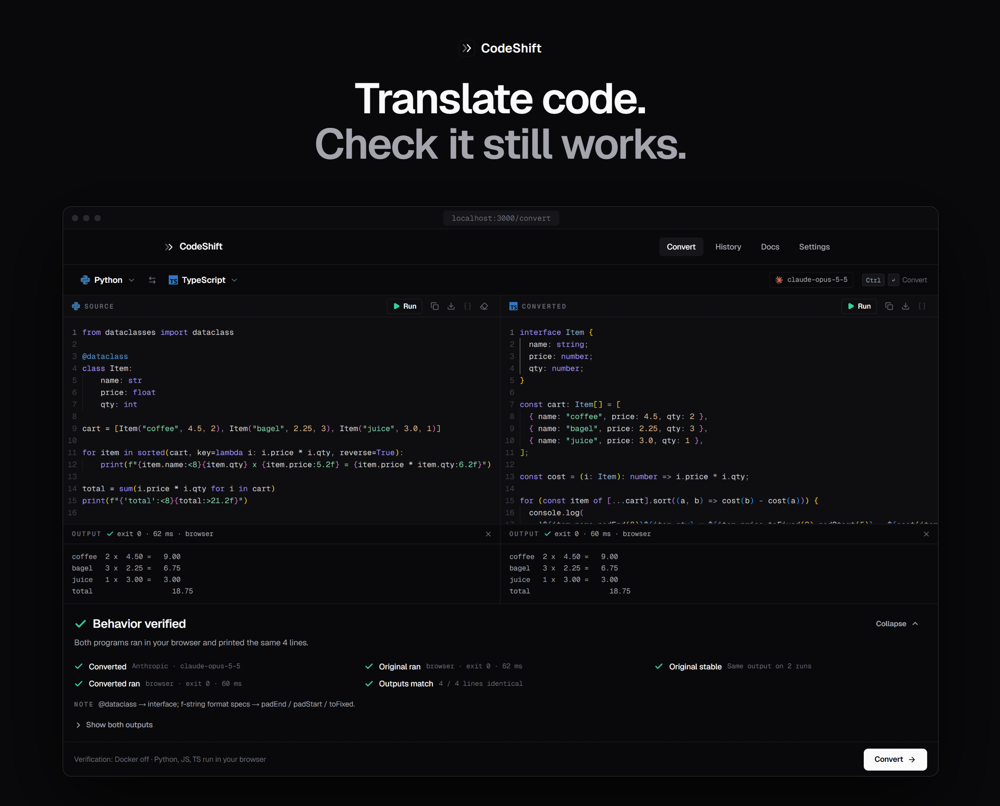
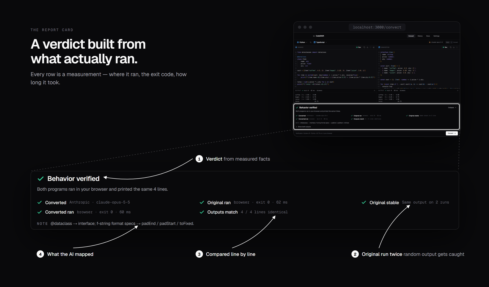
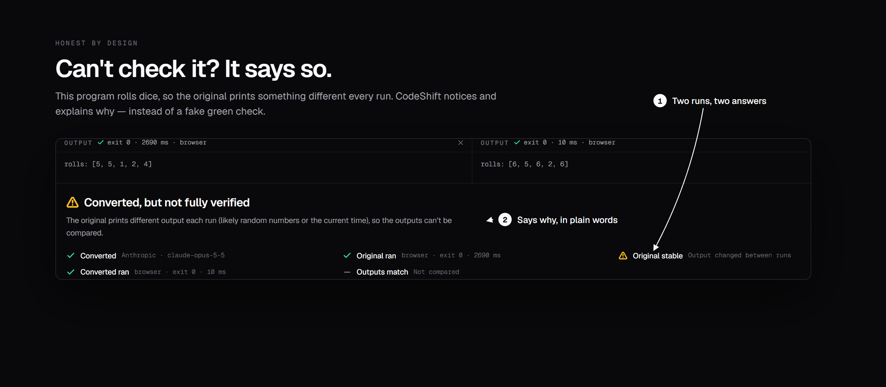
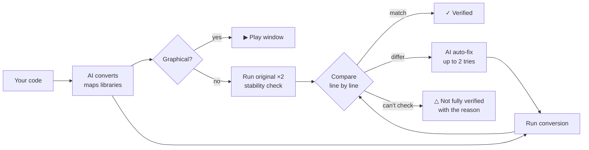
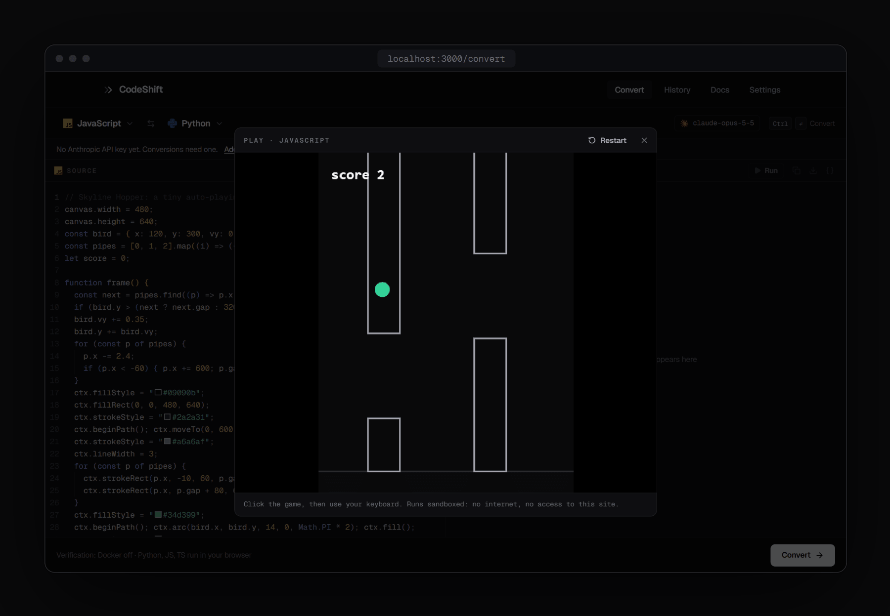
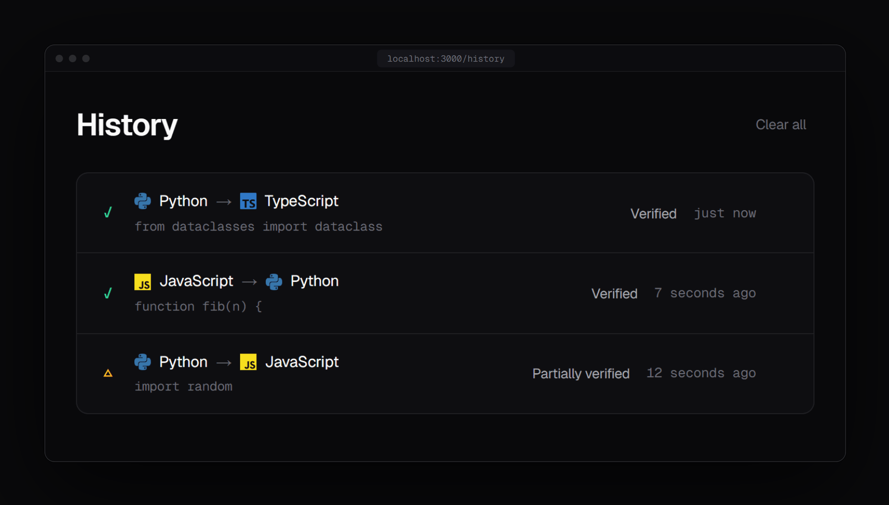
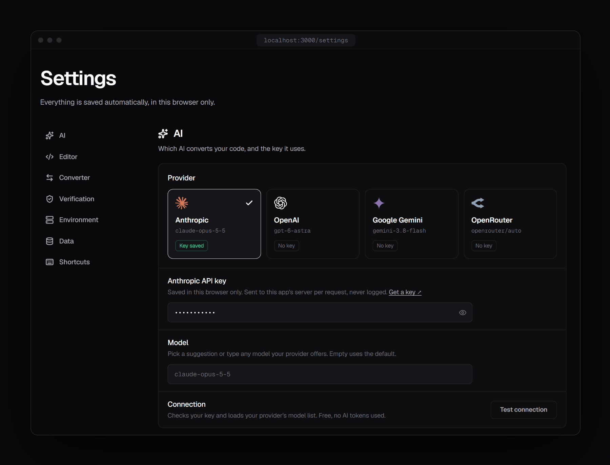
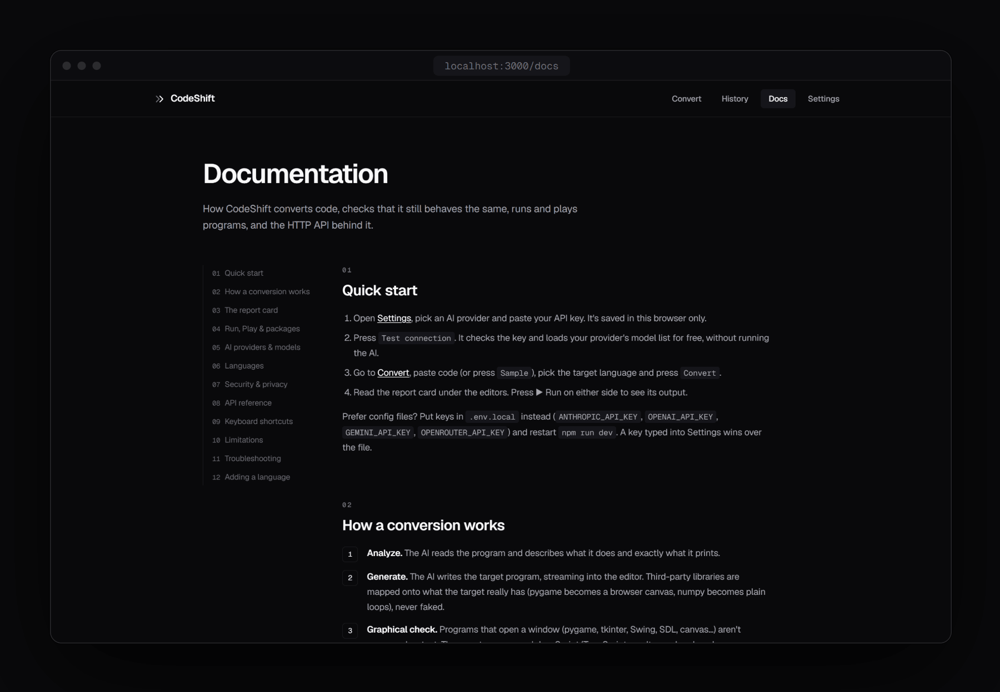

<div align="center">


# CodeShift

**AI converts your code between 10 languages — then runs both programs to check they still behave the same.**

[](LICENSE)


[Quick start](#-quick-start) · [How it works](#-how-it-works) · [Features](#-features) · [API](#-api) · [Contributing](#-contributing)

<br/>



</div>

<br/>

## ✨ Why CodeShift

Most AI converters end with *"Done!"* and code you're asked to trust.

CodeShift **runs the original and the conversion in sandboxes, compares their output line by line, auto-fixes mismatches**, and shows you a report card. A green ✓ appears only when both programs really ran and printed the same thing. When something can't be checked, it tells you why.





## 🚀 Quick start

> Needs **Node.js 22.18+** and an API key from any [supported provider](#-ai-providers).

```bash
git clone https://github.com/Suraj64x/CodeShift.git
cd CodeShift
npm install
npm run dev
```

Open **http://localhost:3000** → **Settings** → pick a provider, paste your key, press **Test connection**. Done.

<details>
<summary><b>Prefer environment variables?</b></summary>
<br/>

Copy `.env.example` to `.env.local` and fill in any of these. A key typed into Settings wins over the file.

```bash
ANTHROPIC_API_KEY=
OPENAI_API_KEY=
GEMINI_API_KEY=
OPENROUTER_API_KEY=
```
</details>

<details>
<summary><b>Run Java, C, C++, Go, Rust, PHP and Ruby too (Docker)</b></summary>
<br/>

Python, JavaScript and TypeScript run right in your browser. For the other seven, start [Docker Desktop](https://www.docker.com/products/docker-desktop/) and pull the images once:

```bash
docker pull python:3.12-alpine node:22-alpine eclipse-temurin:21-jdk-alpine gcc:14 golang:1.23-alpine rust:1-alpine php:8.3-cli-alpine ruby:3.3-alpine
```

Without Docker those languages still convert, but are clearly marked **not verified**.
</details>

## 🔍 How it works



| Verdict | Means |
|---|---|
| ✓ **Behavior verified** | Both programs ran and printed identical output. |
| △ **Not fully verified** | Something couldn't be checked — no runtime, random output, a graphical program. The report says which. |
| ✕ **Output mismatch** | Outputs still differ after auto-fix. You see the first differing line and what the AI tried. |

> Same output on a run is strong evidence, not a proof — and CodeShift never claims more than it measured.

## 🧩 Features

- 🧾 **Report card, not a promise** — every check with where it ran, exit code and time, plus the AI's diagnosis for each auto-fix.
- ▶️ **Run & Play** — run either side instantly; canvas games and drawings open in a sandboxed Play window.
- 🔁 **Smart library mapping** — pygame → canvas, numpy → plain loops. The AI is told never to fake a missing import.
- 📦 **Python packages, auto-installed** — numpy, pandas, matplotlib, pygame and ~300 more load from your imports, in the browser.
- 🤖 **Bring any AI** — Anthropic, OpenAI, Google Gemini or OpenRouter, any model id.
- 🕘 **History** — every conversion is saved locally with its verdict; click one to reopen it.
- 🔒 **Private by default** — your code never runs on the server; keys stay in your browser.

<table>
  <tr>
    <td width="50%"></td>
    <td width="50%"></td>
  </tr>
  <tr>
    <td align="center"><sub><b>Play</b> — graphical JS/TS in a locked-down sandbox</sub></td>
    <td align="center"><sub><b>History</b> — verdicts saved with every conversion</sub></td>
  </tr>
  <tr>
    <td width="50%"></td>
    <td width="50%"></td>
  </tr>
  <tr>
    <td align="center"><sub><b>Settings</b> — pick a provider, test your key</sub></td>
    <td align="center"><sub><b>Docs</b> — built in, including the API reference</sub></td>
  </tr>
</table>

## 🤖 AI providers

| Provider | Default model | Get a key |
|---|---|---|
| Anthropic | `claude-opus-5-5` | [console.anthropic.com](https://console.anthropic.com/settings/keys) |
| OpenAI | `gpt-6-astra` | [platform.openai.com](https://platform.openai.com/api-keys) |
| Google Gemini | `gemini-3.8-flash` | [aistudio.google.com](https://aistudio.google.com/apikey) |
| OpenRouter | `openrouter/auto` | [openrouter.ai](https://openrouter.ai/keys) |

Any model your provider offers works — **Test connection** loads your key's live model list.

## 🌐 Languages

| Runs in your browser | Runs in Docker |
|---|---|
| Python · JavaScript · TypeScript | Java · C · C++ · Go · Rust · PHP · Ruby |

## 🔒 Security

- **No user code on the server.** Docker runs get a fresh container each time: no network, 256 MB, 1 CPU, 15 s timeout, read-only filesystem.
- **Browser runs** use Web Workers with the network blocked.
- **Play window** is an opaque-origin `sandbox="allow-scripts"` iframe with a `default-src 'none'` CSP — no storage, cookies or network.
- **API keys** stay in your browser, travel only to your own server in the `x-ai-key` header, and are never logged.
- **Cross-site requests** to the AI and execute routes are refused.

## 🔌 API

| Route | Does |
|---|---|
| `POST /api/ai/convert` | Convert code — streams NDJSON (`analysis-delta`, `code-delta`, `done`, `error`) |
| `POST /api/ai/fix` | Repair a conversion whose output didn't match |
| `POST /api/ai/models` | List the models a key can use (free) |
| `POST /api/execute` | Run one program in the Docker sandbox |
| `GET  /api/capabilities` | Which keys, Docker and languages are available |

```bash
curl -N http://localhost:3000/api/ai/convert \
  -H "Content-Type: application/json" \
  -H "x-ai-key: $ANTHROPIC_API_KEY" \
  -d '{"provider":"anthropic","model":"claude-opus-5-5","sourceLanguage":"python","targetLanguage":"javascript","sourceCode":"print(sum([1, 2, 3]))"}'
```

Full request/response shapes: **Docs → API reference** in the app.

## 🗂️ Project structure

```
app/              pages (/, /convert, /history, /docs, /settings) and /api/*
components/       UI — editors, report card, Run & Play windows, landing
lib/
  types.ts        the shared contract every layer builds against
  languages.ts    the 10 language configs — add a language here
  ai/             providers: anthropic.ts (SDK) + openai-compat.ts
  client/         browser pipeline, execution, history & settings
  execution/      Docker sandbox runner
  report.ts       turns measured results into the report card
public/workers/   in-browser runners: Pyodide, JS, TS
```

## 🤝 Contributing

Issues and pull requests are welcome.

- **Add a language** with one entry in `lib/languages.ts` — editors, prompts, sandboxes and docs all read from it.
- **Keep the honesty rule:** never show a green check unless both programs ran and their outputs matched.
- Before a PR: `npm run lint`, `npm run check` and `npm run build`.

## ⚠️ Limitations

- Programs that need typed input, network or files can't be auto-verified.
- Graphical programs aren't compared as text; only JavaScript/TypeScript can be played.
- Browser Python is Pyodide — a few stdlib modules are missing and only its prebuilt packages install.

## 📄 License

[MIT](LICENSE) © 2026 Suraj64x

<sub>Built with [Next.js](https://nextjs.org), [Monaco](https://microsoft.github.io/monaco-editor/), [Pyodide](https://pyodide.org), [Framer Motion](https://motion.dev) and [Lucide](https://lucide.dev). Logos from [Simple Icons](https://simpleicons.org) (CC0) and [Lobe Icons](https://github.com/lobehub/lobe-icons) (MIT) are trademarks of their owners, shown for identification only.</sub>
