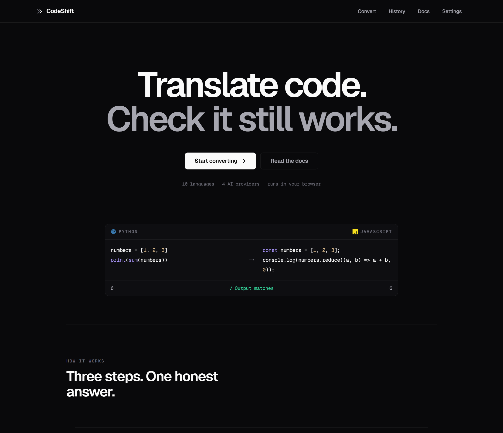
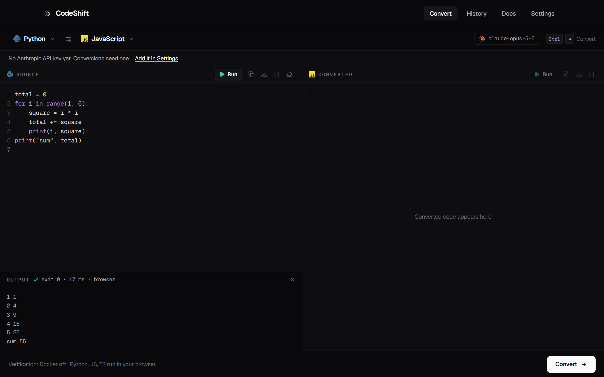
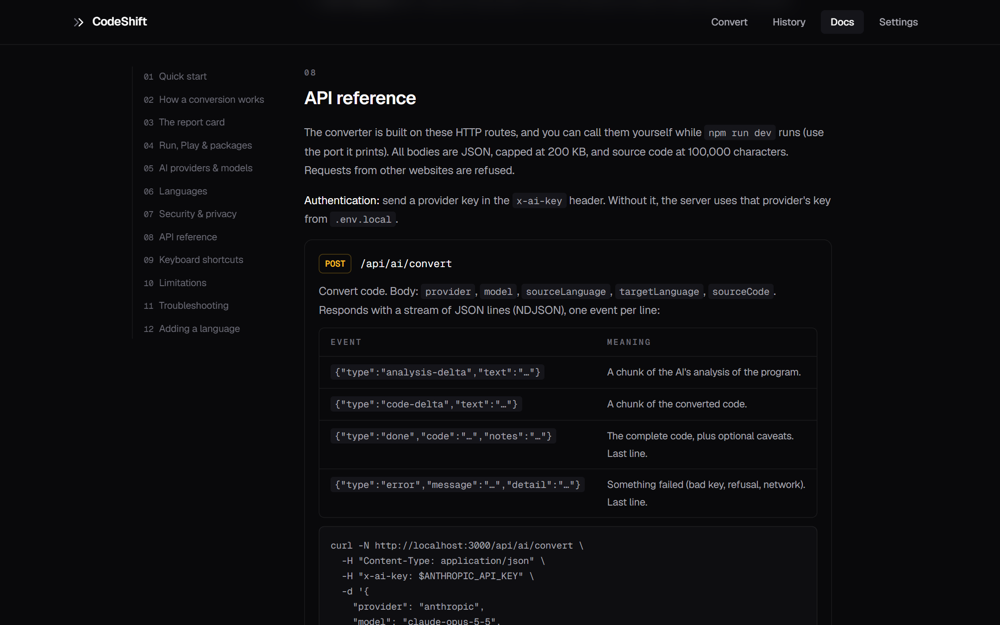
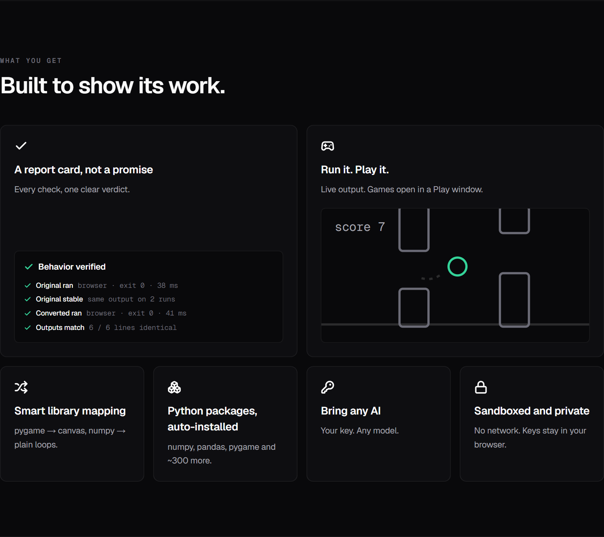
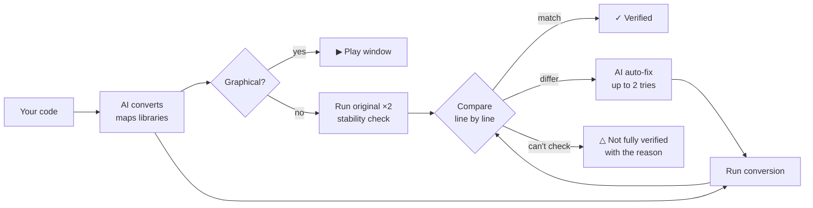

<div align="center">


# CodeShift

### Translate code. Check it still works.

AI converts your code between 10 languages.<br/>
Then CodeShift **runs both programs** and shows you whether they actually behave the same.

[](LICENSE)


<br/>



</div>

---

## The idea

Every AI code converter ends the same way: *"Done!"* and a block of code you're asked to trust.

CodeShift doesn't ask for trust. After converting, it **executes the original and the
conversion in sandboxes, compares their output line by line, auto-fixes mismatches, and
hands you a report card**. A green check appears only when both programs really ran and
printed the same thing. When something can't be checked, it says so instead of guessing.

> Same output on a run is strong evidence, not a mathematical proof — and CodeShift never
> claims more than it measured.

## What it looks like

<table>
  <tr>
    <td width="50%" valign="top">
      
      <p><b>▶ Run either side.</b> Python runs via Pyodide right in your browser; output, errors and timing show up live.</p>
    </td>
    <td width="50%" valign="top">
      
      <p><b>▶ Play graphical programs.</b> Canvas games and drawings open in a sandboxed Play window — no network, no access to the site.</p>
    </td>
  </tr>
  <tr>
    <td width="50%" valign="top">
      
      <p><b>Bring any AI.</b> Pick a provider, paste a key, test the connection, choose any model.</p>
    </td>
    <td width="50%" valign="top">
      
      <p><b>Documented API.</b> Every route the converter uses, with streaming events and curl examples.</p>
    </td>
  </tr>
</table>



## How a conversion works



| Verdict | Means |
|---|---|
| ✓ **Behavior verified** | Both programs ran and printed identical output. |
| △ **Not fully verified** | Something couldn't be checked — missing runtime, random output, a graphical program. The report says which. |
| ✕ **Output mismatch** | Outputs differ even after auto-fix. You see the first differing line and what the AI tried. |

## Features

- **Report card, not a promise** — one row per check (what ran, where, exit code, time, matching lines), a verdict written from measured facts, and the AI's diagnosis for every auto-fix.
- **Run & Play** — run either editor's code and see output instantly; graphical JS/TS opens in a sandboxed canvas window.
- **Smart library mapping** — the AI maps libraries onto what the target really has (pygame → canvas, numpy → plain loops) and is forbidden from faking a missing import.
- **Python packages, auto-installed** — numpy, pandas, scipy, matplotlib, pygame and ~300 more load from your imports in the browser.
- **Bring any AI** — Anthropic (Claude), OpenAI, Google Gemini or OpenRouter, any model id, free "Test connection".
- **Honest by design** — random/time-based programs are detected by running the original twice, so they're never blamed on the conversion.
- **Sandboxed & private** — user code never runs on the server; keys stay in your browser and are never logged.

## Quick start

**Requirements:** Node.js 22.18+ · an API key from one of the providers below · *optional:* [Docker Desktop](https://www.docker.com/products/docker-desktop/) to run Java, C, C++, Go, Rust, PHP and Ruby.

```bash
git clone https://github.com/Suraj64x/CodeShift.git
cd CodeShift
npm install
npm run dev
```

Open <http://localhost:3000>, go to **Settings**, pick a provider, paste your key and press **Test connection**. That's it.

<details>
<summary>Prefer environment variables?</summary>

Copy `.env.example` to `.env.local` and fill in any of:

```bash
ANTHROPIC_API_KEY=
OPENAI_API_KEY=
GEMINI_API_KEY=
OPENROUTER_API_KEY=
```

A key typed into Settings takes priority over the file. `.env.local` is git-ignored.
</details>

<details>
<summary>Enable the Docker languages</summary>

Start Docker Desktop and pull the runtime images once:

```bash
docker pull python:3.12-alpine node:22-alpine eclipse-temurin:21-jdk-alpine gcc:14 golang:1.23-alpine rust:1-alpine php:8.3-cli-alpine ruby:3.3-alpine
```

The exact list for your checkout is on the **Docs → Languages** page and in **Settings → Environment**.
</details>

## AI providers

| Provider | Default model | Key |
|---|---|---|
| Anthropic (Claude) | `claude-opus-5-5` | [console.anthropic.com](https://console.anthropic.com/settings/keys) |
| OpenAI | `gpt-6-astra` | [platform.openai.com](https://platform.openai.com/api-keys) |
| Google Gemini | `gemini-3.8-flash` | [aistudio.google.com](https://aistudio.google.com/apikey) |
| OpenRouter | `openrouter/auto` | [openrouter.ai](https://openrouter.ai/keys) |

Any model id the provider offers works — **Test connection** loads your key's live model list.

## Languages

| Language | Runs in |
|---|---|
| Python · JavaScript · TypeScript | Browser (Pyodide / Web Workers) and Docker |
| Java · C · C++ · Go · Rust · PHP · Ruby | Docker |

## Security & privacy

- **No user code on the server.** Docker runs get a fresh container each time: no network, 256 MB, 1 CPU, 15 s timeout, read-only filesystem, output cap. Browser runs use Web Workers with the network blocked.
- **Play window** — an opaque-origin `sandbox="allow-scripts"` iframe with a `default-src 'none'` CSP: no storage, no cookies, no network.
- **API keys** live in your browser's storage, travel only to your own server in the `x-ai-key` header, and are never logged or stored server-side.
- **Cross-site requests** to the AI and execute routes are refused, so other websites can't use your local server or your credits.

## API

The converter is built on plain HTTP routes you can call yourself:

| Route | Does |
|---|---|
| `POST /api/ai/convert` | Convert code — streams NDJSON events (`analysis-delta`, `code-delta`, `done`, `error`) |
| `POST /api/ai/fix` | Repair a conversion whose output didn't match |
| `POST /api/ai/models` | List the models a key can use (free) |
| `POST /api/execute` | Run one program in the Docker sandbox |
| `GET  /api/capabilities` | Which keys, Docker and languages are available |

```bash
curl -N http://localhost:3000/api/ai/convert \
  -H "Content-Type: application/json" \
  -H "x-ai-key: $ANTHROPIC_API_KEY" \
  -d '{"provider":"anthropic","model":"claude-opus-5-5","sourceLanguage":"python","targetLanguage":"javascript","sourceCode":"print(sum([1, 2, 3]))"}'
```

Full reference with request/response shapes: **Docs → API reference** in the app.

## Project structure

```
app/                 Next.js routes — pages (/, /convert, /history, /docs, /settings) and /api/*
components/          UI — converter (editors, report card, Run & Play windows), landing, shared
lib/
  types.ts           the shared contract every layer builds against
  languages.ts       the 10 language configs — add a language here, by configuration
  ai/                provider abstraction: anthropic.ts (SDK) + openai-compat.ts (OpenAI, Gemini, OpenRouter)
  client/            browser-side pipeline, execution, history & settings stores
  execution/         Docker sandbox runner
  report.ts          turns measured results into the plain-English report card
  play.ts            the sandboxed Play window document
public/workers/      in-browser runners: Pyodide (Python), JS & TS
docs/                screenshots and design notes
```

## Development

```bash
npm run dev      # dev server
npm run build    # production build (type-checks)
npm run lint     # ESLint
npm run check    # self-checks: report wording, graphical detection, Play sandbox, JS runner
```

## Contributing

Contributions are welcome — open an issue or a pull request.

- **Add a language** by adding one entry to `lib/languages.ts` (runtime, Docker image, run command, sample, library notes). The editors, AI prompts, sandboxes and docs all read from it.
- Keep the honesty rule: **never show a green check unless both programs actually ran and their outputs matched.**
- Run `npm run lint`, `npm run check` and `npm run build` before opening a PR.

## Limitations

- Programs that need typed input, network or files can't be auto-verified (sandboxes give no input and no network).
- Graphical programs aren't compared as text; only JavaScript/TypeScript can be played.
- Without Docker, seven of the ten languages convert but stay unverified.
- Browser Python is Pyodide: some stdlib modules are missing and only its prebuilt packages install.

## License & credits

[MIT](LICENSE) © 2026 Suraj64x

Built with [Next.js](https://nextjs.org), [Monaco Editor](https://microsoft.github.io/monaco-editor/), [Pyodide](https://pyodide.org), [Framer Motion](https://motion.dev) and [Lucide](https://lucide.dev).
Language and company logos come from [Simple Icons](https://simpleicons.org) (CC0) and [Lobe Icons](https://github.com/lobehub/lobe-icons) (MIT); they are trademarks of their respective owners, shown only for identification.
